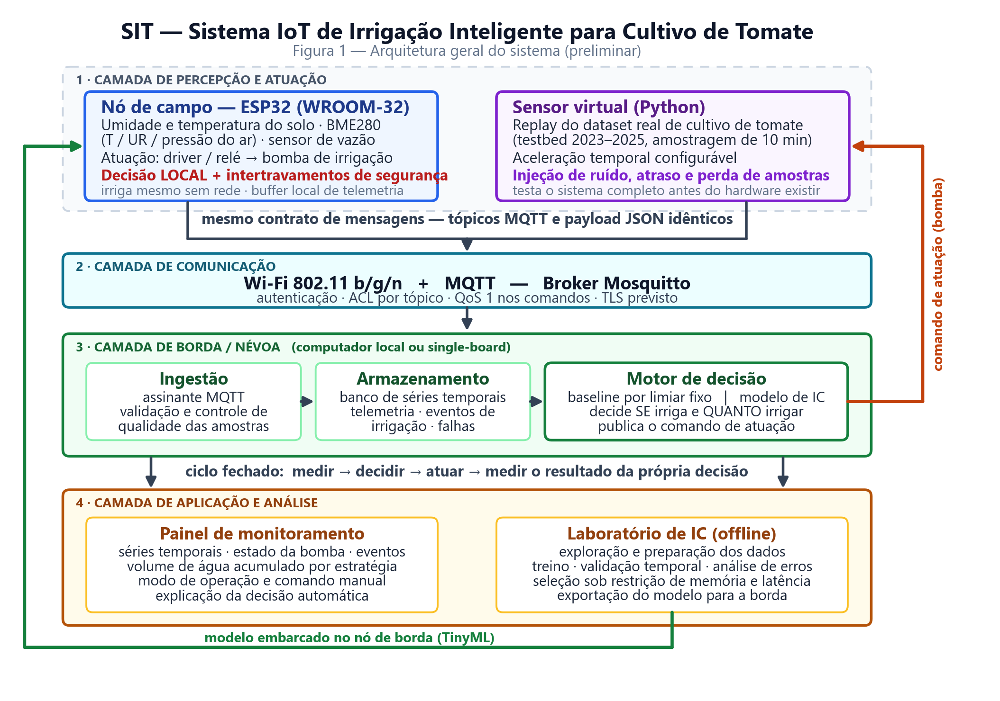

# SIT — Sistema IoT de Irrigação Inteligente para Cultivo de Tomate

Projeto integrado das disciplinas **Internet das Coisas (TI0179)** e **Projeto Integrado IV
/ Inteligência Computacional** — Departamento de Engenharia de Teleinformática, UFC.

> **Pergunta de engenharia que orienta o projeto**
> É possível **reduzir o consumo de água** mantendo a **umidade do solo em faixa adequada**
> ao desenvolvimento do tomateiro?

O SIT mede as condições do solo e do ambiente, decide de forma adaptativa quando e quanto
irrigar usando um modelo de Inteligência Computacional treinado sobre dados reais de
cultivo de tomate, aciona a irrigação e **mede o resultado da própria decisão** — fechando
o ciclo `medir → decidir → atuar → medir`.

O projeto é único e entregue de forma incremental nas duas disciplinas: IoT cuida de
dispositivos, comunicação, arquitetura e visualização; IC cuida da formulação do problema,
dos dados, do modelo e da sua validação. **A interface entre as duas é o contrato de
mensagens MQTT** — os mesmos tópicos que trafegam a telemetria definem as *features* do
modelo.

---

## Sumário

- [O que estamos construindo](#o-que-estamos-construindo)
- [Arquitetura](#arquitetura)
- [Estrutura do repositório](#estrutura-do-repositório)
- [Dados](#dados)
- [Entregas](#entregas)
- [Como trabalhar neste repositório](#como-trabalhar-neste-repositório)
- [Decisões de projeto já tomadas](#decisões-de-projeto-já-tomadas)
- [Equipe](#equipe)

---

## O que estamos construindo

O sistema é desenvolvido em **duas frentes que convergem**:

| Frente | O que é | Por que existe |
| :-- | :-- | :-- |
| **IoT Virtual** | Um *sensor virtual* em Python que reproduz (*replay*) um conjunto de dados real de cultivo de tomate publicando via MQTT, nos mesmos tópicos e no mesmo formato do dispositivo físico. | Permite construir e validar **toda** a cadeia — ingestão, persistência, decisão, painel e modelo — antes do hardware existir, e injetar falhas de campo de forma controlada (ruído, perda de amostras, atraso, queda do broker). |
| **Protótipo físico** | Um nó ESP32 com sensores de baixo custo, bomba e medição do volume aplicado, irrigando uma planta de tomate real. | É a prova de que a inteligência **funciona fora do notebook**. Como o contrato de mensagens é o mesmo, trocar do virtual para o real não exige reescrever o sistema. |

O que **não** é: um temporizador com sensor. Um controlador de limiar fixo já existe e é o
nosso *baseline* — a linha de base que o modelo precisa **superar**, medida no mesmo
período e nas mesmas condições.

### Critério de sucesso

O sucesso **não** é a acurácia de um modelo isolado. É a combinação de três coisas:

1. **Menos água aplicada** que o *baseline* por limiar fixo (volume medido, não estimado);
2. **Sem perda de conforto hídrico** — a fração de tempo com umidade em faixa adequada
   não pode cair. *Economizar água causando estresse na planta é falha, não economia*;
3. **Modelo executável na borda** — ≤ 100 kB e ≤ 100 ms de inferência no ESP32. Um modelo
   que não cabe no dispositivo é descartado, por melhor que seja a métrica.

---

## Arquitetura



Quatro camadas, com duas origens de dados intercambiáveis sob o mesmo contrato de
mensagens. Dois laços fecham o sistema: o **comando de atuação**, que volta da camada de
decisão para a bomba, e o **modelo treinado**, exportado do laboratório de IC para
execução no nó de borda.

Ponto arquitetural que orienta tudo: **a decisão essencial roda no nó**. Sem Wi-Fi, sem
broker, sem nuvem, o ESP32 continua irrigando com a última política válida e guarda a
telemetria para sincronizar depois. A camada de borda agrega, analisa e supervisiona — não
é caminho crítico para a planta sobreviver.

### Contrato de mensagens MQTT (preliminar)

```
sit/{origem}/{zona}/telemetria/solo        nó → broker   umidade e temperatura do solo
sit/{origem}/{zona}/telemetria/ambiente    nó → broker   temperatura, UR e pressão do ar
sit/{origem}/{zona}/telemetria/agua        nó → broker   vazão e volume acumulado
sit/{origem}/{zona}/estado                 nó → broker   modo, bomba, saúde do nó (retained)
sit/{origem}/{zona}/evento/irrigacao       nó → broker   início, duração, volume, estratégia
sit/{origem}/{zona}/comando/bomba          broker → nó   comando de acionamento (QoS 1)
sit/{origem}/{zona}/config                 broker → nó   limiares e parâmetros (retained)
```

`{origem}` é `campo` para o nó físico e `virtual` para o sensor de replay — **mesmo
esquema, mesmos consumidores**. Exemplo de payload:

```json
{
  "ts": "2026-09-08T14:32:00-03:00",
  "dispositivo": "esp32-sit-01",
  "zona": "z1",
  "umidade_solo_pct": 27.4,
  "temp_solo_c": 23.1,
  "qualidade": "ok"
}
```

### Hardware previsto

ESP32 DevKit v1 (WROOM-32) · sensor capacitivo de umidade do solo v1.2 · DS18B20 à prova
d'água · BME280 · sensor de vazão YF-S401 ou bomba peristáltica calibrada · módulo relé ou
driver MOSFET · mini bomba 5 V. Orçamento-alvo do nó: **até R$ 400**.

Os sensores foram escolhidos para **espelhar as grandezas presentes no conjunto de dados
de referência** (umidade e temperatura do solo, temperatura e umidade do ar, pressão,
volume de água). É essa correspondência que torna legítimo treinar o modelo com dados do
testbed e aplicá-lo ao protótipo.

---

## Estrutura do repositório

```
PI4-ICA-IoT/
├── README.md                       ← você está aqui
├── docs/
│   ├── disciplina/                 material das disciplinas (slides, template da entrega)
│   ├── entregas/
│   │   └── v0-descricao-da-aplicacao/
│   │       ├── SIT-v0-descricao-informal.md     ← FONTE DA VERDADE do documento
│   │       ├── SIT-v0-descricao-informal.docx   ← gerado; é o que se entrega/cola
│   │       └── figuras/                          gerado por tools/
│   └── pesquisa/
│       ├── papers/                 artigos de referência (PDF)
│       └── notas/                  notas de pesquisa, links, sensores candidatos
├── data/
│   ├── README.md                   catálogo e dicionário dos conjuntos de dados
│   └── raw/                        datasets originais, intactos (.zip) — versionados
├── notebooks/                      exploração, treino e validação (IC)
├── firmware/                       código do nó ESP32
├── services/
│   ├── virtual-sensor/             replay do dataset → MQTT
│   ├── broker/                     configuração do Mosquitto
│   └── dashboard/                  painel de monitoramento
└── tools/
    ├── md2docx.py                  converte os documentos de entrega para .docx
    └── gerar_figura_arquitetura.py gera a Figura 1 (PNG + SVG)
```

**Regra:** `data/raw/` é imutável. Nada é editado lá dentro. Todo dado derivado nasce de
um script ou notebook versionado e vai para `data/interim/` ou `data/processed/`, que são
ignorados pelo git porque são reproduzíveis.

---

## Dados

Fonte principal: **testbed real de cultivo de tomate** (Mendeley Data, DOI
`10.17632/h8sfcf9487.1`), com três temporadas (2023–2025), cinco linhas de cultivo e
amostragem de 10 minutos. Complementado pelo conjunto **STUARD**, que compara linhas
irrigadas com 100%, 60% e 30% da recomendação — ou seja, dá contraste direto entre
políticas hídricas.

O catálogo completo, com as variáveis de cada arquivo, está em
**[`data/README.md`](data/README.md)**.

Para extrair os dados localmente (os `.zip` ficam intactos):

```bash
python -c "import zipfile,glob,os; [zipfile.ZipFile(z).extractall('data/interim') for z in glob.glob('data/raw/*.zip')]"
```

---

## Entregas

Calendário da disciplina de IoT, mapeado às seis fases do projeto:

| Entrega | Data | Fase / marco | Escopo |
| :-: | :-: | :-- | :-- |
| **v0** | 09/09 | Fase 1 — Problema e dados (M1) | Descrição da aplicação, requisitos funcionais e não funcionais, arquitetura preliminar, seleção do dataset. **[→ documento](docs/entregas/v0-descricao-da-aplicacao/SIT-v0-descricao-informal.md)** |
| **v1** | 14/10 | Fases 2–3 — Modelo e IoT Virtual (M2) | Exploração dos dados; sensor virtual publicando via MQTT; nó ESP32 coletando; gráficos das coletas; *baseline* por limiar. |
| **v2** | 11/11 | Fases 3–4 — Validação e arquitetura (M3–M4) | Modelo de IC treinado e validado; análise de erros; decisão integrada; comparação com o *baseline*; arquitetura Edge/Fog consolidada. |
| **v3** | 25/11 | Fase 5 — Protótipo físico (M5) | Atuação em planta real; análise avançada; painel e dashboards; medição do volume aplicado. |
| **v4** | 07/12 | Fase 6 — Integração e validação (M6) | Sistema integrado funcionando; modelo embarcado; resultado experimental; relatório técnico e workshop. |

Cada entrega vale 20% da nota. A documentação é **cumulativa**: cada versão estende a
anterior em vez de substituí-la.

---

## Como trabalhar neste repositório

### Gerar o `.docx` de uma entrega

O Markdown em `docs/entregas/` é a fonte da verdade — ele é que entra em revisão de código
e mostra diff. O `.docx` é artefato gerado:

```bash
pip install python-docx matplotlib
python tools/gerar_figura_arquitetura.py                                     # figuras
python tools/md2docx.py docs/entregas/v0-descricao-da-aplicacao/SIT-v0-descricao-informal.md
```

Nunca edite o `.docx` à mão: a próxima geração sobrescreve. Edite o `.md` e regere.

### Convenções

- **Documentos** em Markdown, uma frase por conceito, linhas de até ~95 colunas — isso faz
  o diff do git mostrar exatamente a frase alterada.
- **Nomes de arquivo** em `kebab-case`, sem acentos e sem espaços.
- **Commits** em português, no imperativo, descrevendo o *porquê*:
  `docs(v0): substitui tabela de aplicativos semelhantes por comparáveis reais`.
- **Segredos nunca entram no repositório.** Credenciais do broker ficam em `.env` local,
  a partir de um `.env.example` versionado.
- **`.gitattributes` marca PDF, DOCX, XLSX e ZIP como binários.** Isso não é detalhe: três
  PDFs deste repositório foram corrompidos (reduzidos a 2 bytes) por conversão de fim de
  linha antes dessa configuração existir.

---

## Decisões de projeto já tomadas

Registradas aqui para não serem rediscutidas a cada reunião. Mudar uma delas exige
justificativa e atualização deste arquivo.

| # | Decisão | Motivo |
| :-: | :-- | :-- |
| 1 | **ESP32** como nó sensor/atuador | Wi-Fi integrado, ADC, I²C/1-Wire, memória suficiente para inferência embarcada, custo baixo. |
| 2 | **MQTT** como protocolo de aplicação | Leve, orientado a eventos, desacopla produtores de consumidores; painel, armazenamento e motor de decisão assinam os mesmos tópicos sem se conhecerem. |
| 3 | **Decisão essencial roda no nó**, não na nuvem | A planta não pode depender de conectividade para ser irrigada. A borda agrega e supervisiona; o nó decide. |
| 4 | **Sensor virtual antes do hardware** | Permite validar o pipeline completo desde a v1 e testar falhas de rede sem depender de hardware ou de clima. |
| 5 | Tarefa de IC = **previsão de umidade do solo** em horizonte curto; a decisão é derivada da previsão | O rótulo de irrigação no dataset reflete a política do testbed, não a necessidade da planta. A previsão é reaproveitável para estimar a lâmina e é avaliável com métricas contínuas. |
| 6 | **Limiar fixo como *baseline* obrigatório** | Sem linha de base declarada não há como afirmar que a IA melhorou alguma coisa. |
| 7 | **Restrição de borda aplicada na seleção do modelo**, não no fim | Evita descobrir na v4 que o modelo aprovado não cabe no ESP32. |
| 8 | **Divisão treino/teste temporal**, por temporada | Divisão aleatória em série temporal vaza informação futura e produz métrica falsamente boa. |
| 9 | **Medir o volume de água aplicado** | Sem hidrômetro ou bomba calibrada, "economia de água" é afirmação sem evidência. |

### Escopo declarado

**Dentro:** uma zona de irrigação; uma planta/canteiro de tomate; decisão binária com
estimativa de lâmina; comparação contra *baseline*; painel; sensor virtual.

**Fora desta edição:** múltiplas zonas com balanceamento hidráulico; fertirrigação e NPK;
previsão meteorológica externa; app móvel nativo; alimentação solar.

**Limitação assumida:** o ciclo do tomateiro é mais longo que o semestre letivo. Não
haverá validação agronômica de produtividade — a validação é por consumo de água e
manutenção da umidade em faixa adequada.

---

## Equipe

| Integrante | Frente que conduz |
| :-- | :-- |
| Alisson Jaime Sales Barros | Gerência do projeto, arquitetura e integração |
| Gabriel Vaz de Oliveira | Hardware e firmware (nó ESP32) |
| José Ferreira Lessa | Comunicação, infraestrutura de dados e painel |
| Matheus Rocha Gomes da Silva | Inteligência computacional (dados, modelo, validação) |

As frentes indicam quem **conduz** cada área, não exclusividade. Conforme a disciplina
exige, todos participam das decisões de arquitetura, modelo, hardware e *trade-offs*, e
todos devem entender o sistema completo.
