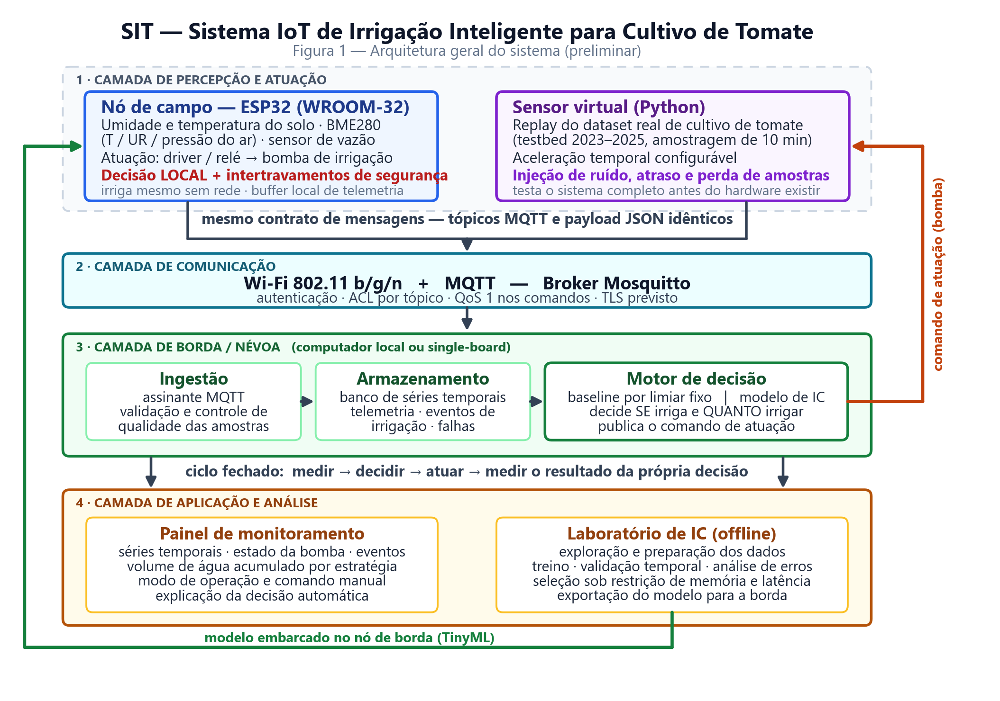

<!-- capa -->
**UNIVERSIDADE FEDERAL DO CEARÁ**  
**DEPARTAMENTO DE ENGENHARIA DE TELEINFORMÁTICA**  
**ENGENHARIA DE COMPUTAÇÃO**  
**INTERNET DAS COISAS (TI0179) — PROJETO INTEGRADO IV**

&nbsp;

**Descrição Informal da Aplicação**

**SIT — Sistema IoT de Irrigação Inteligente para Cultivo de Tomate**

&nbsp;

Alisson Jaime Sales Barros  
Gabriel Vaz de Oliveira  
José Ferreira Lessa  
Matheus Rocha Gomes da Silva
<!-- /capa -->

<!-- quebra-de-pagina -->

## GLOSSÁRIO

| Termo | Definição |
| :-- | :-- |
| **IoT** | *Internet of Things*. Integração de sensores, atuadores, comunicação e software para monitorar e agir sobre o mundo físico. |
| **IC** | Inteligência Computacional. Conjunto de técnicas (aprendizado de máquina, redes neurais, otimização bioinspirada) usadas para extrair decisão a partir de dados. |
| **MQTT** | *Message Queuing Telemetry Transport*. Protocolo leve de mensagens no modelo publicação/assinatura, padrão de fato em IoT. |
| **Broker MQTT** | Servidor que recebe as mensagens publicadas e as distribui aos assinantes dos respectivos tópicos. |
| **QoS** | *Quality of Service* do MQTT. Nível de garantia de entrega da mensagem (0: no máximo uma vez; 1: pelo menos uma vez; 2: exatamente uma vez). |
| **Edge / Borda** | Processamento realizado próximo ao sensor, no próprio dispositivo ou em um nó local, sem depender da nuvem. |
| **Sensor virtual** | Processo de software que reproduz (*replay*) uma série histórica real como se fosse um sensor físico, publicando nos mesmos tópicos MQTT do dispositivo real. |
| **VWC** | *Volumetric Water Content*. Umidade volumétrica do solo, expressa em % do volume. |
| **Capacidade de campo** | Umidade retida pelo solo após a drenagem livre da água gravitacional; limite superior útil para a planta. |
| **PMP** | Ponto de murcha permanente. Umidade abaixo da qual a planta não consegue mais extrair água do solo. |
| **AFD** | Água facilmente disponível. Faixa de umidade entre a capacidade de campo e o limite de reposição recomendado para a cultura. |
| **ETc** | Evapotranspiração da cultura. Volume de água perdido por evaporação do solo e transpiração da planta, em mm/dia. |
| **GDD** | *Growing Degree Days*. Acúmulo térmico usado para estimar o estágio fenológico da cultura. |
| **TinyML** | Execução de modelos de aprendizado de máquina em microcontroladores com recursos severamente limitados. |
| **Baseline** | Estratégia de referência simples (aqui, limiar fixo de umidade) contra a qual o modelo de IC é comparado. |
| **Falso negativo hídrico** | Deixar de irrigar quando a planta precisava — o erro mais caro do sistema, pois causa estresse hídrico irreversível. |

---

## HISTÓRICO DE REVISÕES

| Data | Versão | Descrição | Responsável |
| :-: | :-: | :-- | :-- |
| 08/09/2026 | 0.1 | Descrição informal da aplicação: contexto, requisitos funcionais e não funcionais, arquitetura preliminar e plano de entregas. | Equipe completa |

---

> O projeto é conduzido de forma integrada: as decisões de arquitetura, modelo, hardware e
> *trade-offs* são tomadas em conjunto e todos os integrantes acompanham o sistema
> completo, conforme previsto na disciplina.

## 1. INTRODUÇÃO

A agricultura irrigada responde pela maior parcela da água doce captada no mundo — cerca
de 70% das retiradas globais, segundo a FAO — e é justamente onde as perdas são maiores.
Boa parte dessa ineficiência não vem da falta de água, mas da **falta de informação no
momento da decisão**: irriga-se por calendário, por horário fixo ou por percepção visual do
produtor, sem saber quanta água o solo ainda retém nem quanta a planta vai demandar nas
próximas horas.

No cultivo de tomate esse problema é especialmente crítico. O tomateiro é sensível não
apenas à falta de água, mas à **variação brusca de disponibilidade hídrica**: déficit durante
a floração e a frutificação provoca podridão apical, enquanto excesso após um período seco
causa rachadura dos frutos e favorece doenças fúngicas na zona radicular. A quantidade
correta de água muda ao longo do ciclo — germinação, crescimento vegetativo,
frutificação e maturação têm demandas distintas — e muda também com temperatura,
umidade do ar e radiação do dia. Uma regra fixa não acompanha essa dinâmica.

A automação por si só não resolve o problema. Um controlador que liga a bomba sempre que
a umidade cai abaixo de um limiar continua sendo **reativo**: ele responde ao déficit depois
que ele já ocorreu e ignora a tendência do ambiente. O ganho real está em **antecipar** a
necessidade — estimar como a umidade do solo vai evoluir e decidir a irrigação com base
nessa projeção. Essa é uma tarefa de inferência sobre séries temporais multivariadas e
ruidosas, e é aí que a Inteligência Computacional deixa de ser um enfeite e passa a ser o
componente que define o comportamento do sistema.

Este projeto propõe o **SIT — Sistema IoT de Irrigação Inteligente para Cultivo de
Tomate**: um sistema que mede as condições do solo e do ambiente, decide de forma
adaptativa quando e quanto irrigar por meio de um modelo de IC treinado sobre dados
reais de cultivo de tomate, aciona a irrigação e mede o resultado da própria decisão,
fechando o ciclo **medir → decidir → atuar → medir**. A pergunta de engenharia que
orienta todo o trabalho é a mesma proposta pela disciplina:

> **É possível reduzir o consumo de água mantendo a umidade do solo em faixa
> adequada ao desenvolvimento do tomateiro?**

O sucesso do projeto não será medido pela acurácia de um modelo isolado, mas pela
capacidade de mostrar, com evidência experimental, que a estratégia inteligente aplica
menos água que uma estratégia não adaptativa **sem** levar a planta a estresse hídrico —
e que o modelo escolhido é leve o suficiente para rodar em um dispositivo IoT restrito.

---

## 2. DESCRIÇÃO DA APLICAÇÃO

O SIT é um sistema IoT de ciclo fechado para irrigação de uma zona de cultivo de tomate.
Um nó sensor/atuador baseado em **ESP32** mede continuamente a umidade e a temperatura
do solo e as condições do ar (temperatura, umidade relativa e pressão barométrica),
publica essas medições via **MQTT**, recebe ou calcula localmente a decisão de irrigação,
aciona uma bomba de água e mede o volume efetivamente aplicado. Os dados históricos
alimentam um painel de monitoramento e o processo de treinamento e validação do modelo
de IC.

O desenvolvimento acontece em **duas frentes que convergem**, seguindo as seis fases
definidas na disciplina:

**Frente 1 — IoT Virtual (dados primeiro).** Antes de existir hardware, um *sensor
virtual* reproduz um conjunto de dados real de cultivo de tomate como se fosse um
dispositivo de campo, publicando nos mesmos tópicos MQTT e no mesmo formato de payload
que o nó físico usará. Isso permite construir e testar toda a cadeia — ingestão,
persistência, lógica de decisão, painel e o próprio modelo de IC — com dados de várias
temporadas de cultivo, e permite injetar de forma controlada os problemas que aparecem em
campo: perda de amostras, ruído, atraso de rede e queda do broker.

**Frente 2 — Protótipo físico.** O mesmo pipeline é conectado a um vaso ou canteiro real
com uma planta de tomate, sensores de baixo custo e uma bomba. Como o sensor virtual e o
sensor real publicam com o mesmo contrato de mensagem, o painel, o armazenamento e o
motor de decisão **não precisam ser reescritos**: troca-se a origem dos dados, não o
sistema.

### 2.1 Funcionalidades previstas

- **Aquisição periódica** de umidade do solo, temperatura do solo, temperatura do ar,
  umidade relativa do ar e pressão barométrica.
- **Medição do volume de água aplicado** em cada evento de irrigação — a métrica
  central do projeto, sem a qual não é possível provar economia.
- **Transporte da telemetria por MQTT**, com tópicos padronizados e payload JSON.
- **Armazenamento histórico** das séries temporais para análise e treinamento.
- **Sensor virtual** de reprodução do conjunto de dados real nos mesmos tópicos.
- **Decisão de irrigação por limiar fixo** (*baseline* determinístico e auditável).
- **Decisão de irrigação por modelo de IC**, treinado sobre os dados históricos.
- **Atuação sobre a bomba** com intertravamentos de segurança (tempo máximo de
  acionamento, intervalo mínimo entre irrigações, corte por falha de sensor).
- **Modo autônomo local**: sem rede ou sem broker, o nó continua decidindo e irrigando
  com a última política válida.
- **Painel de monitoramento** com séries temporais, estado da bomba, histórico de
  eventos de irrigação e volume acumulado.
- **Comando manual e seleção de modo de operação** (automático por limiar, automático
  por modelo, manual, desligado).
- **Registro de eventos e detecção de anomalias** de leitura (sensor travado,
  fora de faixa, ausência de resposta à irrigação).
- **Comparação experimental** entre as estratégias, em condições equivalentes.

### 2.2 Integração entre as disciplinas

O SIT é um projeto único, entregue de forma incremental em duas disciplinas com recortes
diferentes:

- **Internet das Coisas (TI0179)** — dispositivos, sensores, atuação, protocolo de
  comunicação, arquitetura Edge/Fog/Cloud, coleta e visualização de dados, segurança.
- **Projeto Integrado IV / Inteligência Computacional** — formulação do problema de
  aprendizado, exploração e preparação do conjunto de dados, construção e validação do
  modelo, análise de erros e adequação do modelo à restrição de execução no dispositivo.

A ponte entre as duas é o contrato de dados: os tópicos MQTT e o esquema de payload
definidos nesta entrega são simultaneamente a interface de rede do sistema IoT e a
fonte das *features* do modelo de IC.

---

## 3. PÚBLICO ALVO

**Usuário primário — pequeno e médio produtor de hortaliças.** Produtor com área
irrigada reduzida, que hoje decide a irrigação por horário fixo ou por avaliação visual,
não dispõe de capital para controladores comerciais proprietários e sofre com custo de
água e energia de bombeamento. Precisa de um sistema barato, que funcione sem internet
estável e que possa ser mantido localmente.

**Usuário secundário — cultivo protegido de pequena escala.** Hortas urbanas,
comunitárias, escolares, estufas didáticas e coleções experimentais, onde a irrigação
manual é irregular (fins de semana, recessos) e o interesse em monitoramento e registro
de dados é alto.

**Usuário terciário — ensino e pesquisa.** Por ser aberto, documentado e reprodutível, o
SIT serve como plataforma de referência para experimentação com políticas de irrigação,
protocolos IoT e modelos embarcados — inclusive para as próximas turmas da disciplina.

Em todos os casos o perfil é o mesmo: **não é especialista em irrigação nem em redes**.
Isso impõe que o sistema seja seguro por padrão, que a decisão automática seja
explicável e que a interface mostre não só o número, mas o motivo da ação.

---

## 4. APLICATIVOS SEMELHANTES

**Tabela 01 — Soluções e trabalhos relacionados**

| Solução / Trabalho | O que faz | Diferencial do SIT |
| :-- | :-- | :-- |
| **Testbed de cultivo de tomate de Parma** (Oddi, Belli, Davoli *et al.*, Mendeley Data, 2026) — conjunto de dados usado neste projeto | Testbed agrícola real, com sensores comerciais Milesight/Talkpool sobre LoRaWAN, monitorando solo, ambiente, pressão, dendrômetros e hidrômetros em 5 linhas de cultivo ao longo de três temporadas, com plataforma Agriware. | O testbed é uma plataforma de **observação**: registra o que aconteceu sob regimes pré-definidos. O SIT usa esses dados como base de treinamento para construir um **controlador de ciclo fechado** de baixo custo, que decide e atua sozinho, e valida a decisão em uma planta física. |
| **Belli *et al.* — cultivo sob diferentes regimes de irrigação** (STUARD) | Compara linhas irrigadas com 100%, 60% e 30% da recomendação Irriframe, medindo a resposta agronômica de cada regime. | Fornece ao SIT o rótulo de referência do que é "irrigar de menos" e "irrigar de mais". O SIT vai além da comparação estática de regimes: a lâmina é **decidida dinamicamente** a cada ciclo pelo modelo. |
| **Nawandar & Satpute (2019)** — irrigação inteligente de baixo custo com rede neural | ESP8266 com modelo neural e comunicação MQTT/HTTP; reporta economia expressiva de água frente à irrigação convencional. | Referência direta de viabilidade em microcontrolador barato. O SIT acrescenta a camada de **validação metodológica** que falta nesse tipo de trabalho: *baseline* explícito, medição do volume por hidrômetro e critério de não degradação da umidade. |
| **Kasera & Acharjee (2024)** — decisão de irrigação por aprendizado por reforço (OSWCP/SIDORT) | Agente de RL sobre hardware LoRa com sensores NPK, otimizando o consumo hídrico em janelas horárias. | Demonstra o teto de desempenho da abordagem adaptativa. O SIT adota deliberadamente um escopo mais conservador — aprendizado supervisionado com modelo embarcável — priorizando **entregar um sistema completo e validado** dentro do semestre. |
| **Controladores comerciais de irrigação** (Rain Bird, Hunter, Netro, LinkTap e similares) | Programação por horário, com ajuste opcional por previsão do tempo (*weather skip*); aplicativo próprio e nuvem proprietária. | São, na prática, temporizadores sofisticados: a maioria **não lê o solo** e nenhum expõe a lógica de decisão. No SIT, sensores, tópicos, limiares, modelo e dados são abertos, inspecionáveis e reprodutíveis. |
| **Projetos abertos genéricos de "irrigação automática com Arduino/ESP32"** | Sensor de umidade + relé + limiar fixo, geralmente com dashboard Blynk ou similar. | Compartilham o hardware, mas param no limiar reativo e não medem o resultado. O SIT trata o limiar apenas como **linha de base a ser superada**, mede o volume aplicado e comprova o ganho experimentalmente. |

**Síntese dos diferenciais do SIT:** (i) decisão adaptativa por modelo de IC treinado em
dados reais de tomate, e não regra fixa; (ii) medição do volume aplicado, permitindo
provar a economia em vez de afirmá-la; (iii) comparação controlada contra um *baseline*
declarado; (iv) restrição de projeto explícita de que o modelo deve caber no dispositivo
de borda; (v) sensor virtual que permite testar o sistema completo antes e depois do
hardware existir; (vi) sistema aberto e documentado ponta a ponta.

---

## 5. DESCRIÇÃO DO SISTEMA

### 5.1 Requisitos da Aplicação

O SIT oferece ao usuário quatro serviços:

1. **Monitoramento** — acompanhar, em tempo quase real e em histórico, a umidade e a
   temperatura do solo, as condições do ar, o estado da bomba e o volume de água
   aplicado.
2. **Decisão automática de irrigação** — determinar, a cada ciclo, se a irrigação deve
   ser acionada e por quanto tempo, usando limiar fixo ou modelo de IC, conforme o modo
   selecionado.
3. **Atuação segura** — acionar a bomba respeitando limites de tempo e intertravamentos
   que impedem alagamento ou funcionamento a seco, com possibilidade de intervenção
   manual a qualquer momento.
4. **Registro e análise** — armazenar medições, decisões e eventos de irrigação de forma
   que o desempenho das estratégias possa ser comparado e o modelo, retreinado.

Nas tabelas a seguir, a coluna **Prio.** indica *E* = essencial, *I* = importante,
*D* = desejável; a coluna **Entrega** indica a versão em que o requisito é atendido.

#### 5.1.1 Requisitos Funcionais

**Tabela 02 — Requisitos Funcionais da Aplicação**

| ID | Requisito funcional | Descrição | Prio. | Entrega |
| :-: | :-- | :-- | :-: | :-: |
| RF01 | Medir umidade do solo | O sistema deve medir a umidade do solo da zona de cultivo em intervalos regulares configuráveis. | E | v1 |
| RF02 | Medir temperatura do solo | O sistema deve medir a temperatura do solo na profundidade da zona radicular. | E | v1 |
| RF03 | Medir condições do ar | O sistema deve medir temperatura, umidade relativa e pressão barométrica do ar. | E | v1 |
| RF04 | Medir o volume de água aplicado | O sistema deve quantificar, por evento de irrigação e de forma acumulada, o volume de água entregue à cultura. | E | v1 |
| RF05 | Publicar telemetria via MQTT | O sistema deve publicar as medições em tópicos MQTT padronizados, com payload JSON contendo identificação do dispositivo, zona, instante e valores. | E | v1 |
| RF06 | Armazenar histórico | O sistema deve persistir as séries temporais recebidas, preservando o instante original da medição. | E | v1 |
| RF07 | Reproduzir dados reais como sensor virtual | O sistema deve dispor de um sensor virtual capaz de reproduzir o conjunto de dados histórico de cultivo de tomate nos mesmos tópicos e formato do dispositivo físico, com fator de aceleração configurável. | E | v1 |
| RF08 | Decidir irrigação por limiar (*baseline*) | O sistema deve decidir o acionamento comparando a umidade medida com limiares de reposição configuráveis, servindo como estratégia de referência. | E | v1 |
| RF09 | Decidir irrigação por modelo de IC | O sistema deve decidir o acionamento a partir da saída de um modelo de inteligência computacional alimentado pelas variáveis medidas e por atributos derivados. | E | v2 |
| RF10 | Estimar a lâmina de irrigação | O sistema deve determinar não apenas *se* irriga, mas *quanto* irrigar, convertendo a decisão em tempo de acionamento da bomba. | I | v2 |
| RF11 | Acionar a bomba | O sistema deve ligar e desligar a bomba de irrigação de acordo com a decisão vigente. | E | v1 |
| RF12 | Aplicar intertravamentos de segurança | O sistema deve interromper a irrigação ao atingir o tempo máximo por evento, respeitar o intervalo mínimo entre eventos e bloquear a atuação diante de leitura inválida de sensor. | E | v1 |
| RF13 | Selecionar o modo de operação | O usuário deve poder selecionar entre os modos desligado, manual, automático por limiar e automático por modelo. | E | v2 |
| RF14 | Permitir comando manual | O usuário deve poder acionar ou interromper a bomba manualmente, com prioridade sobre a decisão automática. | E | v2 |
| RF15 | Registrar eventos | O sistema deve registrar cada evento de irrigação (início, duração, volume, estratégia e valores que motivaram a decisão), além de falhas de sensor e de comunicação. | E | v1 |
| RF16 | Exibir painel de monitoramento | O sistema deve apresentar gráficos das séries temporais, estado atual da bomba, histórico de eventos e volume acumulado por estratégia. | E | v3 |
| RF17 | Explicar a decisão | O painel deve apresentar, junto a cada acionamento automático, os valores que motivaram a decisão. | I | v3 |
| RF18 | Operar de forma autônoma sem rede | Na ausência de conectividade ou do broker, o nó deve continuar decidindo e atuando localmente com a última política válida, e sincronizar os dados retidos ao restabelecer a conexão. | E | v2 |
| RF19 | Configurar parâmetros remotamente | O sistema deve permitir a alteração remota de limiares, período de amostragem e limites de segurança, com aplicação sem necessidade de reprogramação física. | I | v3 |
| RF20 | Detectar anomalias de sensor | O sistema deve identificar leituras fora de faixa, valores estagnados e ausência de resposta do solo à irrigação, sinalizando o evento ao usuário. | I | v3 |
| RF21 | Comparar estratégias | O sistema deve permitir a comparação, sobre o mesmo período, do volume aplicado e do tempo em faixa adequada de umidade sob cada estratégia. | E | v2 |
| RF22 | Exportar dados | O sistema deve permitir a exportação das séries e dos eventos em formato aberto para análise externa. | D | v2 |

#### 5.1.2 Requisitos Não-Funcionais

**Tabela 03 — Requisitos Não-Funcionais da Aplicação**

| ID | Requisito não funcional | Descrição | Prio. | Entrega |
| :-: | :-- | :-- | :-: | :-: |
| RNF01 | Desempenho — amostragem | O período de amostragem deve ser configurável, com padrão de 1 minuto no protótipo físico e 10 minutos na reprodução do conjunto de dados, mantendo compatibilidade com a base histórica. | E | v1 |
| RNF02 | Desempenho — latência | O intervalo entre a leitura do sensor e a sua disponibilização no painel não deve exceder 5 segundos em rede local. | I | v3 |
| RNF03 | Desempenho — tempo de decisão | A decisão de irrigação deve ser produzida em no máximo 1 segundo após a leitura, incluindo a inferência do modelo. | E | v2 |
| RNF04 | Restrição computacional de borda | O modelo de IC embarcado deve ocupar no máximo 100 kB de memória e executar a inferência em menos de 100 ms no ESP32; modelos que não atendam a essa restrição são descartados, independentemente da acurácia. | E | v2 |
| RNF05 | Confiabilidade — atuação | A bomba deve ser desligada incondicionalmente após o tempo máximo configurado por evento (padrão 60 s), mesmo em caso de falha de software, com reforço por temporizador independente. | E | v1 |
| RNF06 | Confiabilidade — recuperação | O nó deve dispor de *watchdog* e reiniciar em estado seguro (bomba desligada) após falha ou queda de energia. | E | v1 |
| RNF07 | Disponibilidade | A função de irrigação não pode depender de conectividade com a internet: a decisão essencial deve ser executável integralmente no nó de borda. | E | v2 |
| RNF08 | Tolerância a falhas | Leituras inválidas devem ser descartadas e sinalizadas; a reconexão MQTT deve usar recuo exponencial; mensagens de telemetria devem ser bufferizadas localmente durante a indisponibilidade do broker. | E | v2 |
| RNF09 | Confiabilidade da entrega | Telemetria deve usar QoS 0 ou 1; comandos de atuação e eventos de irrigação devem usar QoS 1 com identificador que permita descartar duplicatas. | I | v2 |
| RNF10 | Segurança — autenticação | O acesso ao broker deve exigir usuário e senha, com listas de controle de acesso restringindo cada dispositivo aos seus próprios tópicos. | E | v2 |
| RNF11 | Segurança — confidencialidade e integridade | A comunicação deve suportar TLS; comandos de atuação devem trafegar em tópicos separados da telemetria e ser aceitos apenas de origem autorizada. | I | v3 |
| RNF12 | Segurança — credenciais | Nenhuma credencial pode ser versionada no repositório; segredos ficam em arquivo de configuração local a partir de um modelo de exemplo. | E | v1 |
| RNF13 | Usabilidade | O painel deve permitir que um usuário não especialista identifique, em até 10 segundos, o estado atual da irrigação e se há alguma condição anormal. | I | v3 |
| RNF14 | Manutenibilidade | Aquisição, comunicação, decisão e atuação devem ser módulos independentes; parâmetros operacionais ficam em configuração externa, sem valores fixos no código. | E | v1 |
| RNF15 | Reprodutibilidade | Todo o pipeline de dados, treinamento e avaliação deve ser versionado, com sementes aleatórias fixas e divisão treino/teste **temporal**, de modo que os resultados sejam reproduzíveis por terceiros. | E | v2 |
| RNF16 | Interoperabilidade | O contrato de mensagens (tópicos e esquema JSON) deve ser único para o dispositivo físico e para o sensor virtual, permitindo trocar a origem dos dados sem alterar os consumidores. | E | v1 |
| RNF17 | Portabilidade | Broker, armazenamento e painel devem ser executáveis em máquina local ou em computador de borda de baixo custo, com implantação por contêineres. | I | v3 |
| RNF18 | Custo | O custo total de materiais do nó de campo deve ficar abaixo de R$ 400,00, condição de viabilidade para o público-alvo. | E | v1 |
| RNF19 | Energia | O consumo do nó deve ser compatível com alimentação por fonte de 5 V; o uso de modos de baixo consumo entre amostragens deve ser avaliado como caminho para operação autônoma. | D | v3 |
| RNF20 | Robustez ambiental | Eletrônica e conexões devem ser protegidas contra umidade e respingos, e os sensores enterrados devem ter vedação adequada ao contato com solo úmido. | I | v3 |
| RNF21 | Qualidade dos dados | O sistema deve registrar e reportar a taxa de amostras perdidas ou inválidas por período, pois esse valor condiciona a confiança na decisão do modelo. | I | v2 |

### 5.2 Descrição da arquitetura do sistema

> *(Arquitetura preliminar, sujeita a revisão ao longo das entregas.)*



**Figura 1 — Arquitetura geral do sistema SIT.** Fonte: elaboração própria.

As duas origens de dados — o nó físico e o sensor virtual — publicam sob o **mesmo
contrato de mensagens**, de modo que as camadas superiores não distinguem uma da outra.
Dois laços fecham o sistema: o **comando de atuação**, que retorna da camada de decisão
para a bomba, e o **modelo treinado**, que é exportado do laboratório de IC para execução
no nó de borda.

#### 5.2.1 Camada de percepção e atuação

Nó único baseado em **ESP32 (WROOM-32)**, escolhido por reunir Wi-Fi integrado,
conversor analógico-digital, barramentos I²C/1-Wire, poder de processamento suficiente
para inferência embarcada e custo baixo. Responsável pela leitura dos sensores, pela
decisão local de segurança e pelo acionamento da bomba. **A decisão essencial roda no
nó**: mesmo isolado, ele mantém a cultura irrigada.

**Tabela 04 — Materiais previstos para o nó de campo (estimativa)**

| Item | Função | Faixa de custo |
| :-- | :-- | --: |
| ESP32 DevKit v1 (WROOM-32) | Microcontrolador, Wi-Fi, decisão local | R$ 40 – 70 |
| Sensor capacitivo de umidade do solo v1.2 | Umidade do solo (resiste à corrosão, ao contrário do resistivo) | R$ 15 – 30 |
| DS18B20 à prova d'água | Temperatura do solo | R$ 15 – 25 |
| BME280 | Temperatura, umidade relativa e pressão do ar | R$ 25 – 50 |
| Sensor de vazão YF-S401 *ou* bomba peristáltica calibrada | Medição do volume aplicado | R$ 30 – 90 |
| Módulo relé 1 canal 5 V ou driver MOSFET | Acionamento da bomba | R$ 10 – 25 |
| Mini bomba submersa 5 V / peristáltica | Atuação | R$ 20 – 60 |
| Fonte 5 V 2 A, cabos, caixa de proteção, vaso e substrato | Infraestrutura | R$ 50 – 100 |
| **Total estimado** | | **R$ 205 – 450** |

Os sensores foram escolhidos para espelhar, com hardware acessível, as grandezas
presentes no conjunto de dados de referência (umidade e temperatura do solo, temperatura
e umidade do ar, pressão barométrica, volume de água). Essa correspondência é o que torna
legítimo treinar o modelo com dados do testbed e aplicá-lo ao protótipo.

#### 5.2.2 Camada de comunicação

Wi-Fi 802.11 b/g/n como enlace de acesso e **MQTT** como protocolo de aplicação, com
broker **Mosquitto**. MQTT foi escolhido por ser leve, orientado a eventos e desacoplar
produtores de consumidores — o painel, o motor de decisão e o armazenamento assinam os
mesmos tópicos sem se conhecerem. Tecnologias de maior alcance (LoRaWAN) são registradas
como caminho de evolução para a versão de campo, fora do escopo do protótipo.

**Contrato de mensagens (preliminar)**

| Tópico | Direção | Conteúdo |
| :-- | :-- | :-- |
| `sit/{origem}/{zona}/telemetria/solo` | nó → broker | umidade e temperatura do solo |
| `sit/{origem}/{zona}/telemetria/ambiente` | nó → broker | temperatura, umidade relativa e pressão do ar |
| `sit/{origem}/{zona}/telemetria/agua` | nó → broker | vazão instantânea e volume acumulado |
| `sit/{origem}/{zona}/estado` | nó → broker | modo de operação, estado da bomba, saúde do nó (mensagem retida) |
| `sit/{origem}/{zona}/evento/irrigacao` | nó → broker | início, duração, volume, estratégia e valores que motivaram a decisão |
| `sit/{origem}/{zona}/comando/bomba` | broker → nó | comando de acionamento (QoS 1) |
| `sit/{origem}/{zona}/config` | broker → nó | limiares, período de amostragem e limites de segurança (mensagem retida) |

Em `{origem}`, `campo` identifica o nó físico e `virtual`, o sensor de reprodução —
mesmo esquema, mesmos consumidores. Exemplo de payload:

```json
{
  "ts": "2026-09-08T14:32:00-03:00",
  "dispositivo": "esp32-sit-01",
  "zona": "z1",
  "umidade_solo_pct": 27.4,
  "temp_solo_c": 23.1,
  "qualidade": "ok"
}
```

#### 5.2.3 Camada de borda / névoa

Executada em computador local ou computador de placa única. Reúne o broker Mosquitto, um
serviço assinante que valida e persiste a telemetria em banco de séries temporais, o
motor de decisão (limiar ou modelo) e a publicação dos comandos. É aqui que ficam o
histórico completo e a comparação entre estratégias. **O nó de campo não depende desta
camada para irrigar** — ela agrega, analisa e supervisiona.

#### 5.2.4 Camada de aplicação

Painel de monitoramento com séries temporais, estado atual, histórico de eventos, volume
acumulado por estratégia e comando manual. Em paralelo, o ambiente de análise
(*notebooks*) sustenta a exploração dos dados, o treinamento, a validação e a análise de
erros do modelo, cujo artefato final é exportado para execução na borda.

#### 5.2.5 Componentes reutilizados e componentes desenvolvidos

| Reutilizados | Desenvolvidos pela equipe |
| :-- | :-- |
| Broker Mosquitto; bibliotecas MQTT (PubSubClient, paho-mqtt) | Firmware do nó: aquisição, decisão local, intertravamentos e publicação |
| Bibliotecas de sensores (BME280, DallasTemperature/OneWire) | Sensor virtual de reprodução do conjunto de dados |
| Banco de séries temporais e ferramenta de painel | Contrato de tópicos e esquema de payload |
| Bibliotecas de análise e aprendizado (pandas, scikit-learn, TensorFlow Lite Micro) | Pipeline de preparação de dados e engenharia de atributos |
| Conjunto de dados público de cultivo de tomate (Mendeley Data) | Modelo de IC, política de decisão e protocolo experimental de comparação |

### 5.3 Escopo, premissas e restrições

**Dentro do escopo:** uma zona de irrigação; uma planta ou canteiro de tomate; um nó
sensor/atuador; decisão de irrigação binária com estimativa de lâmina; comparação
experimental contra *baseline*; painel de monitoramento; sensor virtual sobre dados
reais.

**Fora do escopo nesta edição:** múltiplas zonas com balanceamento hidráulico; fertirrigação
e controle de NPK; previsão meteorológica externa; aplicativo móvel nativo; operação por
energia solar; certificação para uso comercial.

**Premissas:** disponibilidade de energia elétrica e de rede Wi-Fi no local do protótipo;
acesso ao conjunto de dados público de cultivo de tomate; possibilidade de manter uma
planta viva durante o semestre.

**Restrições:** orçamento de materiais limitado (RNF18); o modelo deve caber no
dispositivo de borda (RNF04); o ciclo do tomateiro é mais longo que o semestre letivo,
de modo que a validação agronômica de produtividade **não** será possível — a validação
se dará por consumo de água e manutenção da umidade em faixa adequada.

### 5.4 Dados e formulação do problema de Inteligência Computacional

**Fonte de dados.** Conjunto de dados público de testbed real de cultivo de tomate
(Mendeley Data), com séries de umidade, temperatura e condutividade elétrica do solo em
duas profundidades, variáveis ambientais (temperatura, umidade relativa, CO₂, pressão),
pressão hidráulica, estado das válvulas, volume medido por hidrômetro e indicadores
agronômicos diários (GDD), amostrados a cada 10 minutos ao longo de três temporadas
(2023–2025), em cinco linhas de cultivo. Complementarmente, o conjunto STUARD registra
três linhas sob regimes de 100%, 60% e 30% da recomendação de irrigação, oferecendo
contraste direto entre políticas hídricas.

**Formulação preliminar.** A tarefa central adotada é a **previsão da umidade do solo**
em horizonte curto (1 a 6 horas), a partir de uma janela de observações recentes de solo
e ambiente. A decisão de irrigação é derivada dessa previsão: irriga-se quando a umidade
projetada tende a cruzar o limite inferior de água facilmente disponível antes do próximo
ciclo. Essa escolha é preferida à classificação direta "irrigar/não irrigar" por três
razões: (i) o rótulo de irrigação nos dados reflete a política do testbed, não a
necessidade real da planta; (ii) a previsão é reaproveitável para estimar a lâmina
(RF10); (iii) é avaliável com métricas contínuas e verificáveis, sem depender de rótulo
subjetivo.

**Atributos previstos:** umidade e temperatura do solo (valor atual, médias e variações
em janelas de 1 h, 3 h e 24 h); temperatura, umidade relativa e pressão do ar; hora do
dia e estação (codificação cíclica); volume irrigado recente e tempo desde a última
irrigação; acúmulo térmico (GDD) como proxy do estágio fenológico.

**Modelos a avaliar**, do mais simples ao mais complexo, conforme a orientação da
disciplina de não perseguir acurácia isolada: persistência (referência ingênua), regressão
linear regularizada, árvores com *gradient boosting*, e uma rede recorrente ou temporal
leve. A seleção considera erro de previsão **e** custo de memória e inferência (RNF04).
A divisão treino/validação/teste é **temporal**, por temporada, para evitar vazamento
de informação futura.

### 5.5 Métricas de avaliação

| Dimensão | Métrica | Critério de sucesso |
| :-- | :-- | :-- |
| Previsão | MAE e RMSE da umidade prevista | Erro inferior ao da previsão por persistência, em teste temporalmente separado |
| Uso de água | Volume total aplicado no período | Redução frente à estratégia *baseline*, no mesmo período e nas mesmas condições |
| Conforto hídrico | Fração do tempo com umidade dentro da faixa adequada à cultura | Igual ou superior à do *baseline* — economia com estresse não é sucesso |
| Segurança agronômica | Número de eventos de estresse (umidade abaixo do limite crítico) | Não superior ao do *baseline* |
| Restrição de borda | Tamanho do modelo e latência de inferência no ESP32 | ≤ 100 kB e ≤ 100 ms |
| Robustez do sistema | Taxa de amostras perdidas e tempo de indisponibilidade | Sistema mantém irrigação segura durante falhas de rede |

O critério decisivo é combinado: **menos água aplicada, sem perda de conforto hídrico,
com modelo executável no dispositivo.** Reduzir água à custa de estresse hídrico
caracteriza falha, não economia.

### 5.6 Plano de entregas

| Entrega | Data | Fase / marco | Escopo previsto |
| :-: | :-: | :-- | :-- |
| **v0** | 09/09 | Fase 1 — Problema e dados (M1) | Este documento: definição do problema, público-alvo, requisitos, arquitetura preliminar, seleção do conjunto de dados e hipótese inicial. |
| **v1** | 14/10 | Fases 2–3 — Modelo e IoT Virtual (M2) | Exploração e limpeza dos dados; sensor virtual publicando via MQTT; nó ESP32 coletando dados reais; gráficos das coletas; *baseline* por limiar; documentação inicial. |
| **v2** | 11/11 | Fases 3–4 — Validação e arquitetura (M3–M4) | Modelo de IC treinado e validado; análise de erros; decisão automática integrada ao pipeline; comparação contra o *baseline*; definição consolidada da arquitetura Edge/Fog. |
| **v3** | 25/11 | Fase 5 — Protótipo físico (M5) | Atuação sobre a bomba em planta real; análise de dados avançada; painel e dashboards; medição do volume aplicado; documentação cumulativa. |
| **v4** | 07/12 | Fase 6 — Integração e validação (M6) | Sistema integrado em operação; modelo embarcado na borda; resultado experimental comparativo; relatório técnico e apresentação no workshop. |

### 5.7 Riscos e mitigações

| Risco | Impacto | Mitigação |
| :-- | :-- | :-- |
| Sensor capacitivo de baixo custo com leitura instável ou não calibrada | Alto — compromete medição e decisão | Calibração em dois pontos (solo seco e saturado); mediana de múltiplas leituras; validação cruzada com pesagem do vaso |
| Diferença entre o solo do testbed europeu e o substrato do protótipo | Alto — o modelo pode não transferir | Normalizar a umidade em relação à faixa útil do próprio solo; recalibrar o modelo com os dados coletados no protótipo |
| A planta não sobreviver ao semestre | Médio — impede validação física | Cultivar mais de um vaso desde o início; espécie de ciclo curto; monitoramento diário |
| Falha de bomba, alagamento ou funcionamento a seco | Alto — dano físico | Intertravamentos por tempo (RNF05, RNF06); teste de atuação sempre com bandeja de contenção |
| Modelo aprovado em métrica mas inviável no ESP32 | Médio — retrabalho tardio | RNF04 aplicado já na seleção do modelo, e não ao final |
| Instabilidade de rede no local do protótipo | Médio | Decisão local no nó e *buffer* de telemetria (RF18, RNF07, RNF08) |
| Desalinhamento entre as entregas de IoT e de PI4 | Médio — retrabalho | Documento e repositório únicos; contrato de dados como interface comum entre as disciplinas |

---

## 6. REFERÊNCIAS

1. ODDI, G.; BELLI, L.; DAVOLI, L.; PREITE, L.; GALAVERNI, M.; RODOLFI, M.; GANINO, T.;
   FERRARI, G. **IoT Dataset from an Evolving Tomato Cultivation Testbed.** Mendeley
   Data, V1, 2026. DOI: 10.17632/h8sfcf9487.1.

2. BELLI, L. *et al.* **IoT-based Dataset of a Tomato Cultivation Under Different
   Irrigation Regimes (STUARD).** Mendeley Data. Conjunto de dados de cultivo de tomate
   sob regimes de 100%, 60% e 30% da recomendação de irrigação.

3. BELLI, L. *et al.* **Smart agriculture dataset in a tomato cultivation under different
   irrigation regimes.** *Data in Brief*.

4. **Smart irrigation for the management of processing tomato.** Artigo sobre manejo
   hídrico de tomate industrial com apoio de sistemas inteligentes.

5. **A Comprehensive IoT edge based smart irrigation system for tomato cultivation.**
   Arquitetura de irrigação inteligente com processamento na borda aplicada ao tomate.

6. **IoT and ML-based automatic irrigation system for smart agriculture system.**
   *Agronomy Journal*, 2023.

7. **An IoT based smart irrigation management system using Machine learning and open
   source technologies.** *Computers and Electronics in Agriculture*.

8. **Ensemble learning-based soil moisture monitoring and sustainable irrigation
   management for Internet of Agricultural Things.**

9. NAWANDAR, N. K.; SATPUTE, V. R. **IoT based low cost and intelligent module for smart
   irrigation system.** *Computers and Electronics in Agriculture*, v. 162, p. 979–990,
   2019.

10. KASERA, R. K.; ACHARJEE, T. **Sistema de irrigação inteligente baseado em
    aprendizado por reforço (OSWCP/SIDORT).** 2024.

11. FAO — FOOD AND AGRICULTURE ORGANIZATION OF THE UNITED NATIONS. **AQUASTAT — Global
    water withdrawal by sector.** Disponível em: <https://www.fao.org/aquastat/>.

12. ALLEN, R. G.; PEREIRA, L. S.; RAES, D.; SMITH, M. **Crop evapotranspiration:
    guidelines for computing crop water requirements.** FAO Irrigation and Drainage
    Paper 56. Roma: FAO, 1998.

13. ROCHA, A.; MULAS, M. **Integrated Project in Computational Intelligence and IoT —
    Course introduction.** Departamento de Engenharia de Teleinformática, UFC, 2026.

> **Nota sobre as referências 3 a 8 e 10:** os PDFs correspondentes estão em
> `docs/pesquisa/papers/`. Os dados bibliográficos completos (autores, volume, páginas e
> DOI) devem ser conferidos e completados antes da versão final do relatório técnico.

---

*Documento gerado a partir do template `docs/disciplina/template-v0-descricao-informal.docx`.
Fonte da verdade versionada em `docs/entregas/v0-descricao-da-aplicacao/SIT-v0-descricao-informal.md`.*
